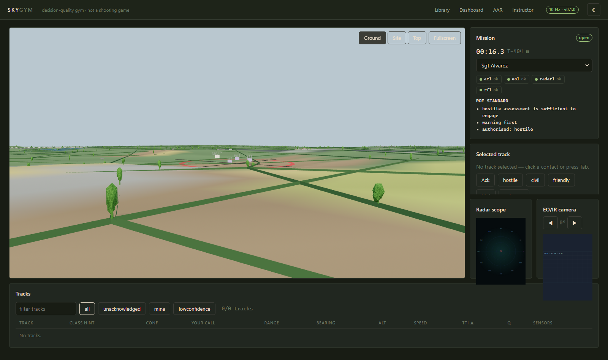
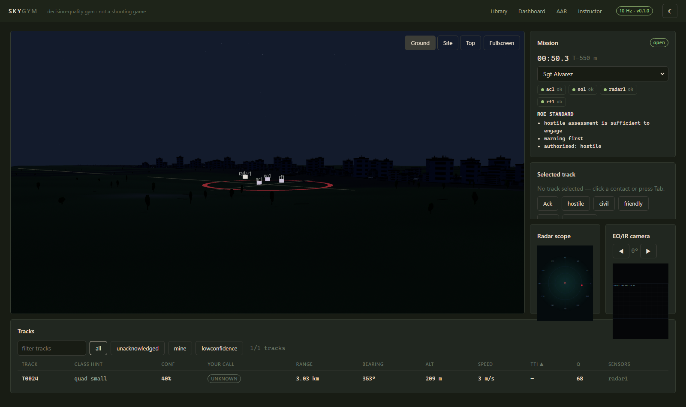
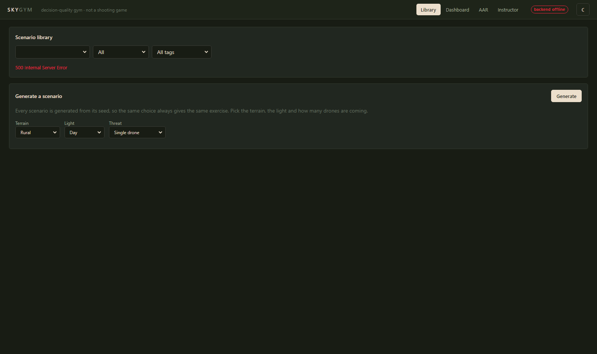

# SKYGYM — drone & counter-drone decision trainer

**Not a shooting game, a decision-quality gym.** SKYGYM is a browser-based desktop
simulator where a trainee defends a site against single drones and swarms in
procedurally generated scenarios. The trainee sees only what the simulated sensors
report, has to detect, identify, prioritise and decide under a rules-of-engagement
(ROE) tree, and is scored on the *decisions* — not on kills. An after-action review
replays the session with a counterfactual ghost, a skill model tracks the trainee
across sessions, and an adaptive adversary ("Red Brain") learns the trainee's habits
so rote learning does not work.

Built for SIH 2026 problem statement 26247.

---

## Safety and scope boundary (read first)

This is a **training and decision-assessment tool**. It contains only generic,
synthetic, abstract parameters:

- Effectors are abstract and non-attributable: **Effector-S** (soft-kill) and
  **Effector-H** (hard-kill) with generic ranges and ammunition counts.
- Sensors are described by abstract detection parameters (range, dwell, detection
  probability curves). There are **no real radar, RF or jamming specifications,
  frequencies, signatures or waveforms**, and no instructions for building,
  defeating or countering any specific real system.
- Entity classes are synthetic categories (`quad_small`, `fpv_fast`, `fixed_wing`,
  `bird_flock`, `kite_balloon`, `friendly_uav`, `civil_aircraft`).

The system is **offline-first**: the application never contacts the internet at
runtime and requires no API keys. Every scenario is produced by the in-process
procedural generator from a seed, so the whole product runs with the network
switched off.

---

## Install and run

Windows-first (GNU Make 4.4, Python 3.11, Node 20). Everything is pinned.

```bash
make install          # python venv + pip deps + npm packages
make check            # lint + type checks + fast tests  (the CI gate)
make demo             # seed demo data, then print the demo URLs
make dev              # backend on :8000, frontend on :5173
```

Then open <http://127.0.0.1:5173>.

| Command | What it does |
| --- | --- |
| `make dev` | Start backend (`:8000`) and frontend (`:5173`) together |
| `make check` | Ruff + ESLint + mypy + tsc + fast pytest (the gate) |
| `make check-all` | `make check` + full pytest + prettier + vitest |
| `make test` / `make test-front` / `make test-full` | Backend fast / frontend / full backend incl. slow sweeps |
| `make seed` | Validate the shipped scenarios and load the demo unit (synthetic) |
| `make reset-db` | Delete the SQLite database and recreate an empty schema |
| `make migrate` / `make migration` | Apply / author Alembic migrations |
| `make schemas` | Export JSON Schema for every wire model into `docs/schema/` |
| `make headless` | Run one scenario headlessly from the command line |
| `make live-demo` | Play one session over the live API and print the score (needs `make dev`) |
| `make demo` | `make seed` + the demo path |
| `make e2e` | Playwright smoke test against a running stack |

The first `make seed` on an empty database plays 20 synthetic sessions so the
dashboards have real history, which takes about five minutes on a modest laptop;
every later run is seconds, because it only simulates what is missing. For a
richer dashboard use `SKYGYM_DEMO_SESSIONS=20 make seed` (20 per trainee).

---

## Architecture in one screen

```
browser (React 18 + Vite + @react-three/fiber)
   |  WebSocket: 10 Hz state_frame snapshots        ^ trainee actions
   v                                                |
FastAPI (offline, localhost)  --  live.py + clock.py: server-authoritative 10 Hz
   |  api/*: sessions, aar, scenarios, users, analytics, instructor
   v
core/ (pure, deterministic)  engine.step() -> sensors -> tracking -> ROE -> scoring
   |                                                        oracle / generator / skills / redbrain
   v
SQLite (WAL) + SQLAlchemy 2 + Alembic migrations
```

Full detail: [`docs/architecture.md`](docs/architecture.md). Scoring:
[`docs/scoring.md`](docs/scoring.md). Demo: [`docs/demo_script.md`](docs/demo_script.md).

### The world

The 3D environment is **generated by the backend from the scenario seed**, not faked in
the browser. The same heightfield that masks radar rays is the ground you walk on, and
the road network, city blocks, village clusters, field patchwork, hedgerows, ponds and
vegetation are laid out around it by `core/worldgen.py`. The client receives one compact
payload (`GET /api/scenarios/{id}/environment`) and renders it in about twenty
instanced draw calls.

| | Rural | Urban |
| --- | --- | --- |
| Ground | rolling heightfield, irregular fields with crop and soil colours | built-up ground between blocks, asphalt roads |
| Settlement | village clusters of gabled and hipped houses along lanes, farmsteads with sheds and silos | arterial spines with parallel streets and cross streets, blocks of shops, apartments, towers and warehouses, pocket parks, car parks |
| Landscape | hedgerows along field boundaries, woodland, ponds, drainage channels, farm tracks | street trees, lamps, walls, kerbs, centre-line markings |

Buildings are procedurally detailed (roofs, parapets, balconies, awnings, chimneys) and
every texture is painted on a canvas at start-up — **no downloads, no new dependencies,
nothing to break offline**. Three camera views are one click away: **Ground** (eye
height), **Site** (the tactical orbit) and **Top** (overview); WASD pans and the camera
never sinks through the terrain.

| Rural, daylight | Urban, night |
| --- | --- |
|  |  |

Only the footprints a scenario carries block detection; everything the generator invents
for context is scenery. See D033 in [`DECISIONS.md`](DECISIONS.md).


### Determinism (a hard requirement)

The same scenario seed and the same trainee action log always produce the identical
`final_state_hash`, in-process and across a save/load round trip:

- one seeded `numpy.random.Generator`, passed explicitly — no `random`, no wall
  clock inside `core/`;
- `step()` is pure, and the live session, the headless player, the AAR replay and
  the counterfactual fork all call the same function;
- the hash is BLAKE2b over a canonical little-endian float64 encoding;
- identity resolution inside the tracker is order-independent (smallest-id
  tie-break, blank ids never recorded) — this fixed a real bug where the same
  scenario scored differently under different `PYTHONHASHSEED` values.

The AAR displays the stored hash next to the replayed hash; `make check` runs the
determinism tests, including a multi-process hash-seed check.

---

## Scenario library



The library ships **two curated scenarios, one rural and one urban**, and the
generator covers every other combination on demand.

| Scenario | Category | Focus |
| --- | --- | --- |
| `scn_rural_day_patrol` | rural | Daylight, a single fast FPV over open farmland, a radar that degrades two minutes in, and a decoy in the same sector |
| `scn_urban_night_swarm` | city | Night, a six-drone swarm in two overlapping waves, buildings masking the low drones, a degraded EO sensor and civilians in the sector below |

Everything the statement asks for is covered: **day and night**, **urban and rural**,
**single drone and swarm**, and **degraded sensors** — the first two as shipped content,
the rest from the generator, which exposes terrain, time of day and threat composition
as explicit options on the Library page.

Every shipped scenario is validated (structure + sanity + oracle solvability) before it
is stored; `backend/scripts/verify_scenarios.py` re-checks them and prints the oracle
target table:

```
scenario                     preset  category   oracle  verdict
------------------------------------------------------------------------
scn_rural_day_patrol         rural   rural        98.3  ok
scn_urban_night_swarm        urban   city         88.3  ok
------------------------------------------------------------------------
2 scenarios: 1 rural, 1 city
all valid, sanity-clean, categorised and oracle-solvable
```

| Scenario | Oracle | What it proves |
| --- | --- | --- |
| `scn_rural_day_patrol` | 98.3 | A single-drone problem is solvable once the radar drops out |
| `scn_urban_night_swarm` | 88.3 | A night swarm is solvable without fratricide, but only just |

---

## Testing

`make check` runs the fast matrix; `make check-all` adds the slow sweeps, frontend
unit tests and formatting checks.

| Spec 11 suite | Where |
| --- | --- |
| Determinism (same hash, save/load, hash seeds) | `backend/tests/test_p1_core.py`, `test_p4_api.py` |
| Sensors (range / RCS / fog / RF-silent) | `backend/tests/test_p2_sensors_tracking.py` |
| Tracking (continuity, bounded false tracks, stable identity) | `backend/tests/test_p2_sensors_tracking.py` |
| ROE (every verdict, property test) | `backend/tests/test_p3_roe_scoring.py` |
| Scoring (monotonicity, caps, coaching) | `backend/tests/test_p3_roe_scoring.py` |
| Generator (many seeds valid + oracle-solvable + diverse) | `backend/tests/test_generator.py` |
| Skill model (rises/falls, bounded) | `backend/tests/test_p7_skills.py` |
| Red Brain (exploits a fixed blind spot) | `backend/tests/test_p8_redbrain.py` |
| World generation (determinism, roads, occluders) | `backend/tests/test_worldgen.py` |
| API + WebSocket | `backend/tests/test_p4_api.py` |
| Frontend components | `frontend/src/**/*.test.tsx` (vitest) |
| Performance (40 contacts, 4 sensors, tick budget) | `backend/tests/test_perf.py` |

---

## Performance

Measured on the development laptop (Windows, integrated graphics, no GPU), by
`backend/tests/test_perf.py`:

| Scenario | Contacts | Sensors | Mean tick | Budget |
| --- | --- | --- | --- | --- |
| `scn_rural_day_patrol` | 1 | 4 | **0.21 ms** | 20 ms ✓ |
| `scn_urban_night_swarm` | 10 | 4 | **2.89 ms** | 20 ms ✓ |
| Artificial worst case | 40 | 4 | **21.49 ms** (p95 25.13 ms) | 20 ms ✗ |

Measured on the reference laptop (Windows 11, Intel Core i5-1145G7 @ 2.6 GHz,
integrated graphics, no GPU). Every scenario that ships ticks far inside the
spec's 20 ms budget; the artificial worst case of 40 simultaneous contacts is
22.5 ms, which is still four times inside the 100 ms tick period of a 10 Hz
session. The tick was optimised from 61 ms to 22 ms (vectorised terrain
sampling, batched association and duplicate pruning, no per-pair NumPy calls).
**The worst case misses the 20 ms bar by ~12% and that is stated here rather
than hidden**: the number is measured by `backend/tests/test_perf.py`, which
asserts the 45 ms worst-case ceiling and the 20 ms budget for every shipped
scenario.

The browser side draws the world in about twenty instanced or merged draw calls
(terrain, roads, one per building archetype, one per tree species, one per prop
kind) plus one for the contacts, and never re-renders the page per frame.

---

## What is not implemented

Being explicit, as the brief demands:

- **Red Brain Layer B (PPO)** is not implemented in this build: there is no training
  script and no policy file, and the API reports `learned_policy.available: false`.
  Difficulty adaptation runs entirely on Layer A (the contextual bandit), which is
  what the problem statement asks for.
- **Team mode** (multi-trainee sessions) is a stretch phase and is not built.
- **The site digital-twin editor** is not built. The world is generated
  procedurally instead, and heightmap import is not supported.
- **Only two scenarios ship** (one rural, one urban). Every other combination —
  day/night, single/swarm, either terrain — is generated on demand from the
  Library page, which is what the statement asks for ("procedurally generated
  threat scenarios").
- **VR** is not implemented. The statement says "desktop **or** VR-capable", and
  the desktop build is what ships; the scene is WebGL, so it could be wrapped later.
- **PDF export** is a print stylesheet plus CSV export, not a PDF renderer.

